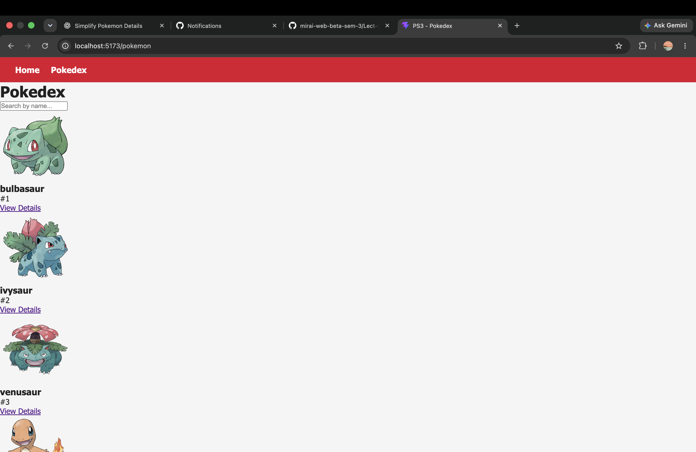
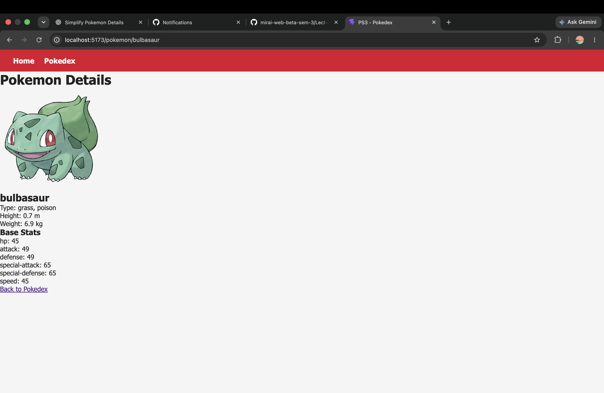

# PS3: Pokedex

## Problem Statement

Build a Pokedex: a grid of Pokemon and a stats page for each one.

## PS Number

PS3

## Project Name

Pokedex

## About

Pokedex is a React SPA built with React Router. The home page shows a hero with an "Open Pokedex" button. The Pokedex page shows 50 Pokemon cards with image, name and number, and lets you search Pokemon by name. Clicking a card opens a stats page showing the big official artwork, types, height, weight and base stats. Unknown URLs show a "Page not found" page with a link back to Home.

Bonus features:

- Each base stat on the details page is shown as a bar.

## Technologies Used

- React
- Vite
- React Router
- CSS

## APIs Used

- PokeAPI - https://pokeapi.co/
- PokeAPI Sprites - https://raw.githubusercontent.com/PokeAPI/sprites/master/sprites/pokemon/other/official-artwork/

## API Routes

| Route | Page shows | API |
| --- | --- | --- |
| `/` | Hero + "Open Pokedex" button | none |
| `/pokemon` | 50 cards: image, name, number; search by name | `https://pokeapi.co/api/v2/pokemon?limit=50` |
| `/pokemon/:name` | Big image, types, height, weight, base stats | `https://pokeapi.co/api/v2/pokemon/:name` |
| `*` | "Page not found" + link to Home | none |

## Screenshots

Home Page


Pokemon List Page



Pokemon Details Page



Page Not Found


## Live Demo

https://ps-03-pokedex-web.vercel.app/

## Installation and Setup

```bash
git clone https://github.com/sapnasingh4852-source/PS3-Pokedex.git
cd PS3-Pokedex
npm install
npm run dev
```

The app runs at http://localhost:5173

## Author

SAPNA SINGH
# pokedex
